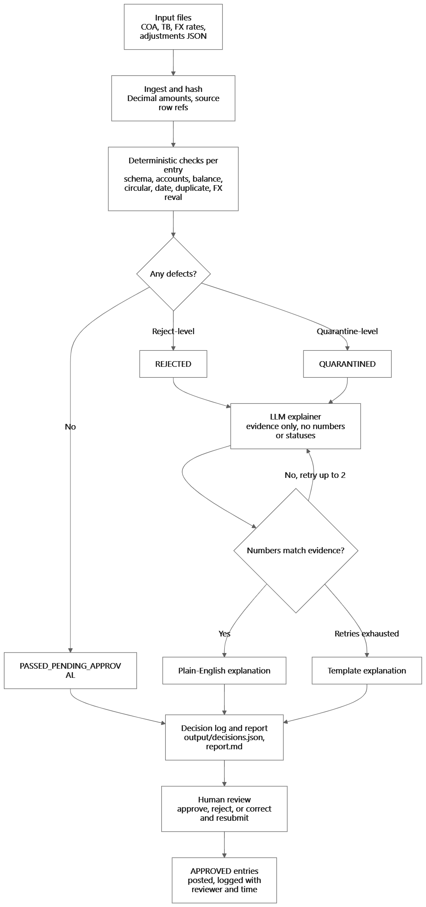

# Manual Adjustments Agent

A prototype for reviewing the unposted 2024-Q4 journal adjustment batch provided with the AI Agentic Engineer assignment. It validates each journal entry with deterministic rules, assigns a review status, and produces an evidence-backed explanation for entries that do not pass.

The prototype does **not** post journal entries or generate financial statements. A `PASSED_PENDING_APPROVAL` result is not an approval to post.

## Workflow



In brief, the agent:

1. Loads the chart of accounts and adjustment entries, and computes a run ID from the COA and adjustment input files.
2. Runs deterministic checks on each entry: schema and line values, COA membership, debit/credit balance, net-zero-per-account entries, reporting-period dates, duplicate IDs, and recognizable EUR cash revaluation entries.
3. Assigns a status in code. A rejection-level defect takes precedence over a quarantine-level defect.
4. For entries with defects, asks the LLM for a plain-language explanation based only on the supplied evidence. It rejects explanations that introduce unsupported numbers, retries up to two times, then falls back to a deterministic template.
5. Writes a JSON decision log and Markdown report for human review. Reviewers must approve, reject, or request correction; the prototype itself does not record approvals or post entries.

The LLM does not perform accounting calculations, change a status, approve an entry, or modify the source data.

## Statuses

| Status | Meaning |
|---|---|
| `PASSED_PENDING_APPROVAL` | Implemented checks passed; a human must still review and approve before posting. |
| `QUARANTINED` | An issue needs investigation or supporting evidence before the entry can proceed. |
| `REJECTED` | A blocking defect was found, such as an unbalanced or net-zero-per-account entry. Correct and resubmit the entry. |

When an entry has multiple defects, `REJECTED` takes precedence over `QUARANTINED`.

## Project files

| File | Purpose |
|---|---|
| `manual_adjustments_agent.py` | Prototype validation pipeline and output generation. |
| `architecture.md` | Proposed system design, controls, assumptions, and prototype scope. |
| `flowchart.png` | Visual workflow for the adjustment agent. |
| `inputs/manual_adjustments.json` | Unposted journal adjustments for 2024-Q4. |
| `inputs/chart_of_accounts.csv` | Account codes used to validate adjustment lines. |
| `inputs/trial_balance.csv` | Source EUR balance used by the implemented FX revaluation check. |
| `inputs/fx_rates.csv` | Source rates used by the implemented FX revaluation check. |
| `inputs/prior_period_tb.csv` | Prior-period data supplied for the broader assignment; not currently read by this prototype. |
| `output/decisions.json` | Per-entry status, defects, evidence, and explanation. Generated when the script runs. |
| `output/report.md` | Human-readable adjustment review report. Generated when the script runs. |

## Setup and run

Use Python 3. Install the script's external dependencies:

```bash
python -m pip install requests python-dotenv
```

From the project root, run:

```bash
python manual_adjustments_agent.py
```

The script expects the `inputs/` and `output/` folders relative to the current working directory. It reads:

- `inputs/chart_of_accounts.csv`
- `inputs/manual_adjustments.json`
- `inputs/trial_balance.csv` and `inputs/fx_rates.csv` for the EUR cash revaluation check

It creates or overwrites `output/decisions.json` and `output/report.md`. Entries without defects receive the message “All checks passed. Awaiting human approval.” and do not require an LLM explanation.

The script uses `python-dotenv` to load local environment configuration and makes an OpenRouter request for defect explanations. If the request fails or the explanation fails number verification, it uses a template explanation instead. Do not commit API keys or other credentials.

## Checks and expected findings

- **Schema:** required entry and line fields; at least two lines; non-empty IDs and accounts; finite, non-negative amounts; no line with both a positive debit and positive credit.
- **COA membership:** an account absent from the COA is quarantined for review.
- **Balance:** total debits must equal total credits exactly using `Decimal`; otherwise reject.
- **Net-zero entry:** reject if every account nets to zero. This detects a no-op pattern; it does not prove a general multi-entity intercompany cycle.
- **Date:** date must be a valid ISO date in the configured period, 2024-10-01 through 2024-12-31.
- **Duplicate ID:** later occurrences of an entry ID are quarantined.
- **EUR cash revaluation:** for an entry containing accounts `1110` and `7310`, compare the booked debit/credit net on `1110` with the EUR cash balance multiplied by the difference between the period-end and period-average EUR rates. A difference greater than one cent is quarantined.

With the supplied batch, the code is expected to reject JE-002 as unbalanced and JE-008 as net-zero per account; quarantine JE-003 for a revaluation mismatch and JE-005 for account `6315` missing from the COA; and leave the other entries `PASSED_PENDING_APPROVAL`, subject to the checks implemented here. The FX calculation uses the supplied EUR balance of 825,400 and rates of 1.082 (average) and 1.095 (period-end), giving an expected revaluation of 10,730.20 versus the booked 11,200.

## Scope and limitations

This prototype evaluates the adjustment batch only. It does not:

- generate the balance sheet, income statement, cash flow statement, or statement of changes in equity;
- translate the full trial balance or reconcile its overall debit/credit difference;
- validate all possible FX-entry forms or infer missing adjustment currency fields;
- perform broad intercompany cycle detection or consolidation;
- persist human approvals, provide an approval interface, or post entries;
- implement all audit lineage and versioning described in `architecture.md`.

The decision log is a local output artifact, not a production audit database. Review every result and supporting source before using an adjustment in accounting records.